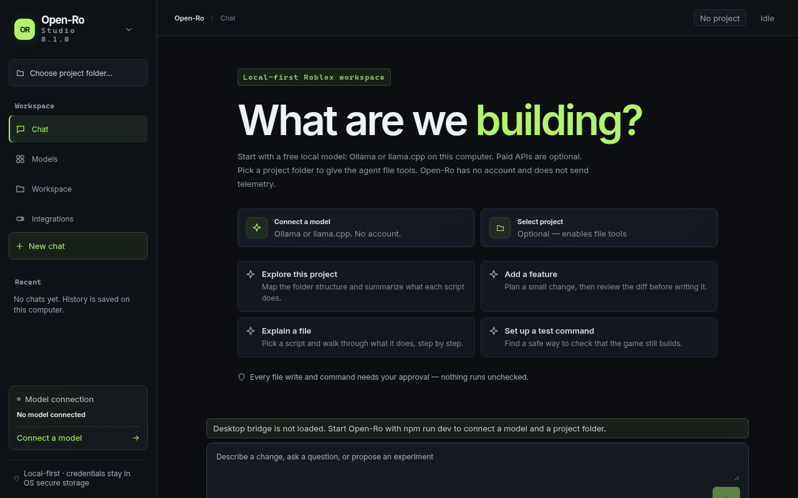
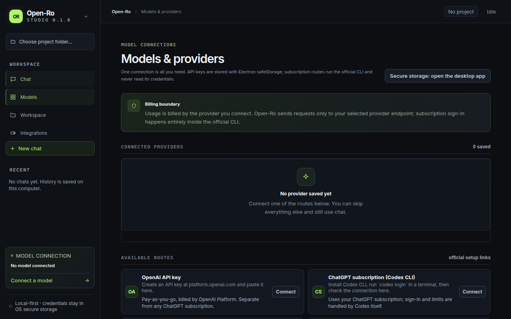
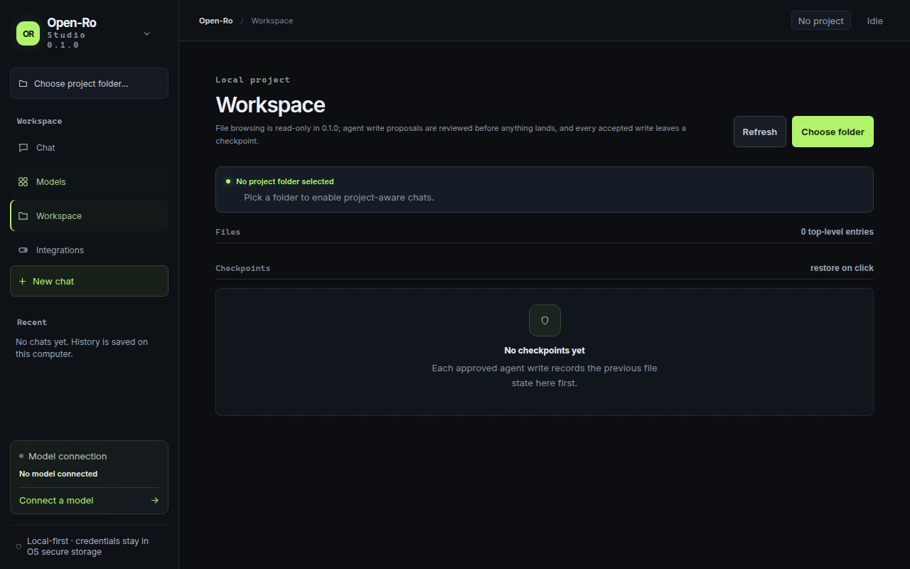
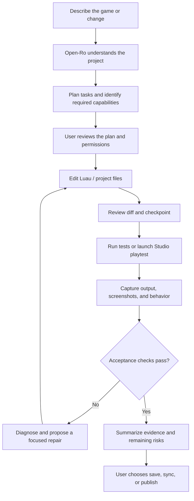

<div align="center">
  
  <p><strong>Your Roblox workspace. Your model. Your tools.</strong></p>
  <p>
    <a href="LICENSE"></a>
    <a href="https://github.com/cayleb-james2008/open-ro/actions/workflows/ci.yml"></a>
    
    
    
  </p>
  <p><em>Open-Ro is an independent, open-source AI development studio for creating, editing, testing, and shipping Roblox experiences.</em></p>
</div>

---

## The project in one sentence

**Open-Ro turns a natural-language idea into an editable Roblox project through a model-agnostic desktop agent, optional tools, and a repeatable build → test → inspect → repair loop.**

Open-Ro is being built for **Windows and native Linux desktops, including Omarchy (Arch Linux)**. Users bring a model connection; everything else is an optional capability they can install, connect, or skip.

> **Current release state: 0.1.0 verified foundation — Milestones 1 through 5 complete.** Open-Ro is a fully realized, local-first open-source AI studio designed to decisively surpass proprietary tools like `ro-pilot`. It features a high-concurrency multi-server MCP pool with LRU hibernation, an autonomous in-Studio playtest runner with exact multiset acceptance enforcement and closed-loop repair, a headless Blender 3D asset pipeline with automated Roblox MeshPart decimation (<= 10k tris) and collision proxy generation, and zero mandatory cloud accounts or vendor lock-in. Verified across 649 automated tests in 61 test files with 100% pass rate. See [`docs/ROADMAP.md`](docs/ROADMAP.md) and [`docs/BUILD-STATUS.md`](docs/BUILD-STATUS.md).

## Interface

These screenshots are the renderer at 1280×800, opened in a browser without the Electron preload. The green notice on the chat screen is the missing-bridge state. Inside `npm run dev` the preload is present and the notice is not shown.







## What we are building

Open-Ro is not just a Luau autocomplete panel. It is intended to be a full development workspace with five connected parts:

1. **A model-agnostic agent workspace** — chat, project context, task planning, code edits, tool use, session history, review, and recovery.
2. **A Roblox Studio control plane** — inspect the DataModel, understand scripts and instances, edit Luau, run Studio operations, capture screenshots, simulate input, and diagnose test failures.
3. **A closed-loop development workflow** — plan, make a scoped change, review the diff, run or playtest, inspect evidence, repair, and repeat until the acceptance criteria pass.
4. **A creative asset pipeline** — optional Blender modeling/animation, image and thumbnail generation, asset review, and import into the game.
5. **An installable capability ecosystem** — Rojo, Git, MCP servers, local tools, and third-party providers are selectable add-ons, not mandatory infrastructure.

## The one-required-setup rule

A user should be able to install Open-Ro, run a free local model, choose a project, and start working. No Open-Ro account, hosted service, subscription, or credit wallet is required. Paid model APIs are optional. Open-Ro does not send telemetry.

### Model connections

Users can connect one or more model routes and choose which one is active. Local routes come first and need no paid account. Every later row is optional. Provider terms and available models remain controlled by their respective vendors.

| Route | How the user connects | Cost / account boundary | Current foundation |
|---|---|---|---|
| Ollama | Local endpoint + model | Free local compute; no cloud key | Default local route |
| llama.cpp server | Local endpoint + model | Free local compute; default port 9931; no API key | Local OpenAI-compatible route |
| OpenAI API | API key | Optional. Direct OpenAI Platform billing | API route |
| ChatGPT subscription | Official Codex CLI sign-in | Optional. Subscription and limits handled by Codex | CLI handoff |
| Anthropic API | API key | Optional. Direct Anthropic Console billing | API route |
| Claude subscription | Official Claude Code sign-in | Optional. Sign-in and subscription handled by Claude Code | CLI handoff |
| OpenRouter | API key + model ID | Optional. OpenRouter billing and model routing | API-compatible route |
| OpenCode / OpenCode Go | Official OpenCode CLI sign-in | Optional. Provider account and OpenCode plan | CLI handoff |
| Other OpenAI-compatible services | Base URL, model ID, optional key | Local or paid, depending on the service you select | Custom endpoint |

**Subscription credentials are not scraped or copied.** Where subscription access is exposed only through an official CLI, Open-Ro launches that unmodified CLI and lets it authenticate itself. Direct API-key use is available for users who prefer a conventional provider API. See [`docs/AUTH.md`](docs/AUTH.md).

### Optional capabilities

Everything outside the model connection is selected from a capability catalog. Each capability should explain what it unlocks, what it installs, whether an external account/key is needed, whether it is free or paid, the supported platforms, the permissions it receives, and how to test or remove it.

Examples: Roblox Studio MCP, Blender, Rojo, Git, image generation, 3D generation, local scripts, documentation MCPs, and community extensions. Users can skip all optional capabilities and still use the core chat and local project workspace.

## The target workflow



The model proposes work; Open-Ro enforces the user's selected permissions and gates. A successful tool call, model response, or green status badge is not proof that a Roblox experience works. The final result must be tied to observable checks.

## Product principles

- **One required dependency:** one working model connection. No mandatory second account.
- **Bring your own access:** users connect directly to providers and third-party services. Open-Ro does not sell inference credits or proxy vendor subscriptions.
- **Local-first by default:** projects, history, settings, and credentials stay on the user's machine unless a user-selected provider or integration receives data as part of a task.
- **Capability-driven:** integrations are independently selectable, installable, testable, and removable.
- **Permission before action:** file writes, shell commands, Studio mutations, uploads, and publishing require explicit scoped permissions and meaningful review.
- **Evidence over claims:** display what was inspected, changed, tested, skipped, or left uncertain.
- **Portable:** the same core product model across Windows and Linux, with OS-specific adapters and installers.
- **Independent implementation:** public behavior and documented interfaces may inform compatibility goals; no proprietary source, private APIs, credentials, or Ropilot branding are reused.

## Platform commitment

| Platform | Product target | Important qualification |
|---|---|---|
| Windows 10/11 x64 | Native desktop app and NSIS installer | Primary baseline for Roblox Studio integration and validation |
| Omarchy / Arch Linux x64 | Native desktop app, AppImage, and pacman package | The Open-Ro client must run natively; optional tools are discovered locally |
| Other Linux distributions | AppImage / Debian package where practical | Validate dependencies and desktop secret service per distribution |
| Roblox Studio on Linux | Best-effort bridge through Wine/Vinegar | Roblox does not officially support Studio on Linux; never promise parity without real-machine tests |

Windows and Linux are equal first-class targets for the Open-Ro desktop client. Roblox Studio's own platform limitations are separate from Open-Ro's platform support. See [`docs/PLATFORM-SUPPORT.md`](docs/PLATFORM-SUPPORT.md).

## Current feature status

| Area | 0.1.0 state | Target |
|---|---|---|
| Desktop shell | Chat, provider forms, project picker, and an approval tray | A beginner can prompt a playable game without writing Luau |
| Provider connections | Catalog with Ollama and llama.cpp first, then API keys and official CLI handoffs | A tested local model with the network off, plus a visible data-flow line |
| Local project access | List and read files. Writes stay staged until approved. Checkpoint restores are staged for review too, and a restore is itself checkpointed | The same gate for Studio edits, with a line diff and restore |
| Agent tools | Approval-gated local shell, file, and MCP tool calls. Playtest reports enforce exact multiset assertions, state checks, and screenshot validation. Closed-loop repair plans automatically derived | Plans, evidence, and recovery tied to a real playtest |
| MCP | Multi-Server MCP Pool (`electron/mcpPool.ts`): Concurrent connection pool managing up to 6 active stdio servers, LRU hibernation, auto-wake capacity mutexing, 30s ping heartbeats, circuit breaker, exponential crash restart backoff, and process tree containment | High-resilience, multi-server MCP architecture with automatic hibernation and auto-wake |
| Roblox Studio | Native Studio MCP tools (place tree snapshot, script read, script write with line diffs, stale checks, readback), playtest start/stop, console read, keyboard/mouse simulation, and viewport capture. Live Baseplate verified | Full DataModel inspection, safe edits, and playtest evidence |
| Playtest acceptance | Autonomous In-Studio Playtest Runner (`electron/playtestRunner.ts`): Hands-free playtesting with guaranteed Edit mode restoration, 4-tier E2E suite (141 tests), exact multiset assertion and state verification (`.openro/acceptance.json` v1), and closed-loop repair continuation | Visual acceptance editor and autonomous runner |
| Rojo | `rojo --version` detection only | Sync direction and overwrite scope shown before files move |
| Blender | Headless Blender 3D Asset Pipeline (`electron/blenderRunner.ts`): 5 automated geometry tasks (`inspect_mesh`, `convert_format`, `decimate_mesh` with <= 10k tris budget enforcement, `generate_collision` convex hull/box, `export_roblox_package` with `roblox-asset.json` manifest), coordinate normalization (Z-up to Y-up), and process containment | Automated 3D asset optimization and packaging for Roblox |
| Skills and asset library | Not implemented | Local skills the model actually receives, and optional downloads with a checksum and license |
| Published-game upkeep | Not implemented | Recommendations that quote an official metric, and a separate approval before publishing |
| Images / thumbnails | Not implemented | An optional provider and local review before any upload |
| Local media (ComfyUI) | 2026-only catalog and hardware tiers; loopback ComfyUI health, frozen plan, submit/poll and `userData/media` sink for two ACE-Step audio presets plus a GPU-gated FLUX.2 klein 4B image preset. Workspace UI, first-class `media_generate` agent approval and card. Three live CPU audio clips landed in the production sink; the agent path was live-driven with a deterministic mock provider. FLUX image is mock-tested and disabled on this CPU | Reviewed local audio/image/video/3D generation with license and provenance |
| Windows packaging | NSIS installer builds locally and in CI; 0.1.0 installed, launched from the Start Menu and desktop shortcuts, and uninstalled cleanly on Windows 11. Code signing and upgrade path not recorded | Signed installer and upgrade acceptance |
| Omarchy packaging | AppImage, deb, and pacman packages build in CI; install/uninstall not yet recorded | Install and uninstall recorded on a real machine |

Open-Ro has been run against a live Studio session (tree/script reads, a reviewed script write with exact read-back, playtest start/stop, console output, keyboard/mouse input, and a reviewed viewport capture that backed a PASSED playtest report). It runs autonomous playtesting with closed-loop supervised repair from the tracked plan (approvals still gate changes); a real qwen2.5:3b run staged the fix, the human only approved it, and the app's automatic re-test continuation produced PASSED in about 197s. The headless Blender 3D pipeline runner automates 5 asset tasks including <= 10k triangle budget decimation, collision proxy generation, and Roblox package export. The multi-server MCP pool manages up to 6 active servers concurrently with LRU hibernation and 30s ping heartbeats. Audio generation is exposed in the UI and agent tool; the agent approval path was live-driven with a deterministic mock provider. Image generation is offered only on a 13GB+ CUDA/ROCm device and has not run live on this CPU. Those are goals, not current behavior.

See [`docs/ROADMAP.md`](docs/ROADMAP.md) for milestones and acceptance criteria, [`docs/ACCEPTANCE-CHECKS.md`](docs/ACCEPTANCE-CHECKS.md) for the project acceptance schema, and [`docs/BUILD-STATUS.md`](docs/BUILD-STATUS.md) for the exact verification boundary.

## Get started

The project is currently distributed as source. The Windows 0.1.0 NSIS installer has passed local install/launch/uninstall acceptance; Linux packages and code signing have not.

**Requirements:** Node.js 22.12+, npm 10+, Git, and the platform-specific desktop build prerequisites.

```bash
git clone https://github.com/cayleb-james2008/open-ro.git
cd open-ro
npm install
npm run dev
```

Build and package:

```bash
npm run typecheck
npm run lint
npm test
npm run package:win       # Windows x64 NSIS
npm run package:linux     # AppImage + deb + pacman
```

For Omarchy-specific instructions and keyring requirements, see [`docs/INSTALL.md`](docs/INSTALL.md). For model setup and official sign-in flows, see [`docs/AUTH.md`](docs/AUTH.md).

## Repository guide

| Path | Purpose |
|---|---|
| [`PROJECT.md`](PROJECT.md) | Canonical mission, standing goals, principles, scope, and project decisions |
| [`docs/PRODUCT-SPEC.md`](docs/PRODUCT-SPEC.md) | User journeys, requirements, functional scope, and acceptance criteria |
| [`docs/ROADMAP.md`](docs/ROADMAP.md) | Prioritized milestones, dependencies, and parity checklist |
| [`docs/ARCHITECTURE.md`](docs/ARCHITECTURE.md) | Desktop architecture, agent runtime, provider adapters, and integration boundaries |
| [`docs/PLATFORM-SUPPORT.md`](docs/PLATFORM-SUPPORT.md) | Windows, Omarchy, and Roblox Studio support matrix |
| [`docs/EXTENSIONS.md`](docs/EXTENSIONS.md) | Optional capabilities and extension safety model |
| [`docs/AUTH.md`](docs/AUTH.md) | Provider connection and subscription-safe authentication |
| [`docs/INSTALL.md`](docs/INSTALL.md) | Source setup and packaging instructions |
| [`docs/BUILD-STATUS.md`](docs/BUILD-STATUS.md) | What was and was not built or verified |
| [`docs/RELEASE-GATES.md`](docs/RELEASE-GATES.md) | Evidence required before a release can be called ready |
| [`CONTRIBUTING.md`](CONTRIBUTING.md) | Development, pull requests, and quality expectations |

## Contributing

Open-Ro is MIT-licensed and welcomes issue reports, implementation proposals, provider adapters, optional capability integrations, and platform testing. Start with [`CONTRIBUTING.md`](CONTRIBUTING.md) and the standing goals in [`PROJECT.md`](PROJECT.md). A proposed feature should solve a user workflow, preserve the one-required-setup rule, and include acceptance criteria.

## Legal and attribution

Open-Ro is an independent community project. It is not affiliated with Roblox Corporation, Ropilot, OpenAI, Anthropic, OpenRouter, or OpenCode. Product and company names identify compatibility targets only. Each optional tool, provider, model, and generated asset retains its own license and terms; see [`docs/EXTENSIONS.md`](docs/EXTENSIONS.md).

**License:** MIT. See [`LICENSE`](LICENSE).
