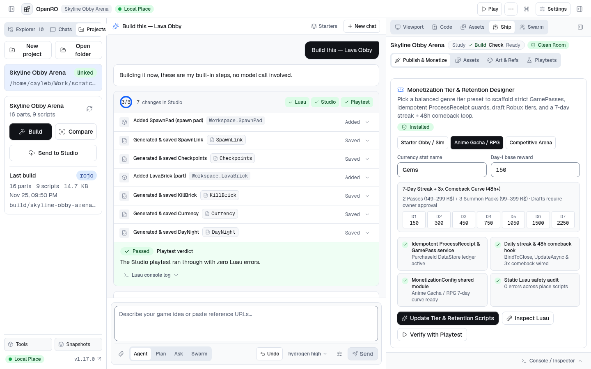
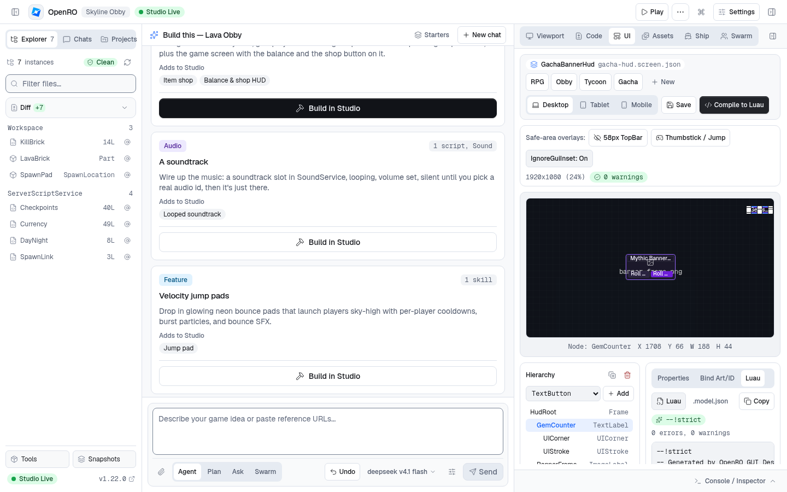
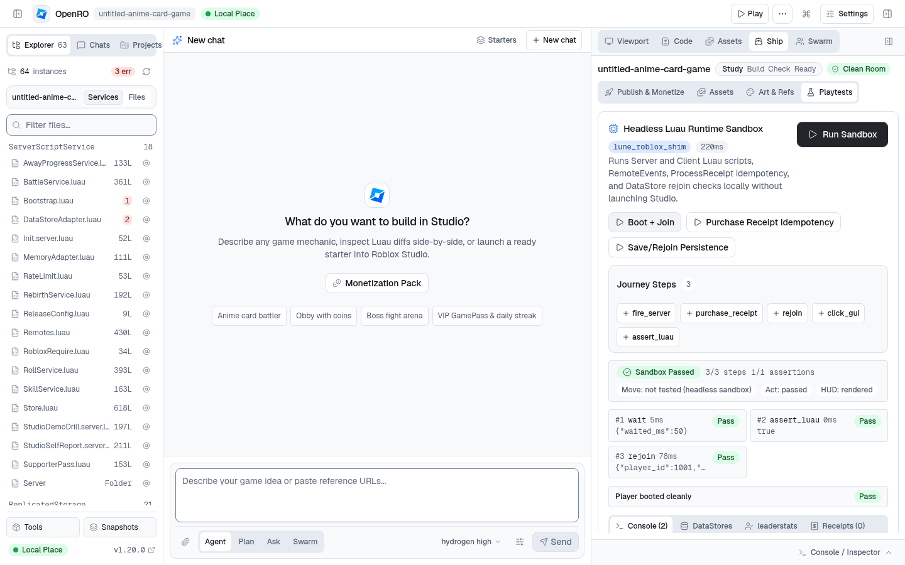
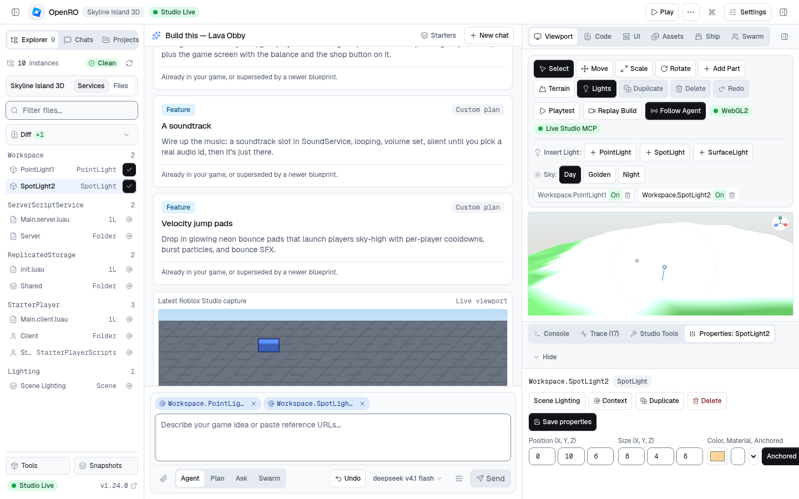
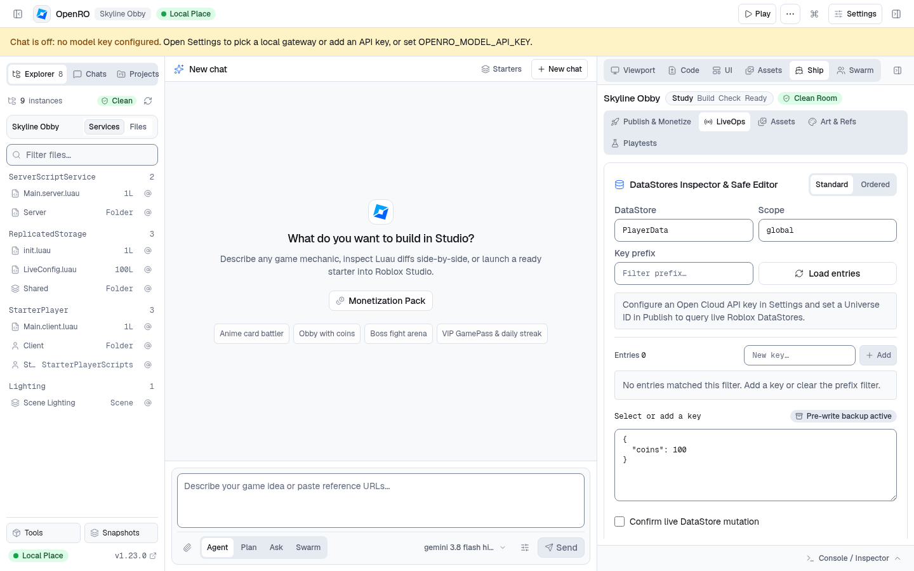
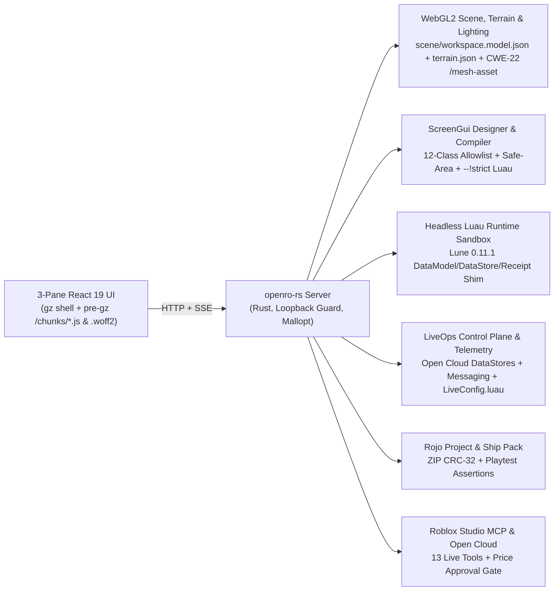

#  OpenRO (`v1.24.0`)

[](https://github.com/cayleb-james2008/open-ro/releases/latest)
[](https://github.com/cayleb-james2008/open-ro/actions)
[](LICENSE)
[](#architecture)

OpenRO is a single-binary Roblox Studio IDE written in Rust with a React 19 interface. It builds, checks, executes headless Luau journeys, monetizes, and publishes Roblox games from Rojo project folders or an embedded Local Place engine, with an offline browser demo (`web-dist/index.html`) that runs the same workflows locally with no external network requests.

<p align="center">
  <picture>
    <source media="(prefers-color-scheme: dark)" srcset="docs/screenshots/hero-dark.png" />
    
  </picture>
</p>

## What it does

- The WebGL2 3D viewport (`frontend/src/app/viewport/`, `StudioViewport3D.tsx`, `src/scene.rs`, and offline `web-engine/install.ts` parity) renders workspace parts, `.obj` meshes, `.png`/`.jpg` textures, sky and fog lighting, water planes, and up to 8 dynamic `PointLight`, `SpotLight`, and `SurfaceLight` sources with an automatic Canvas2D fallback. You can generate `flat`, `hills`, `island`, or `canyon` terrain in `scene/terrain.json` (which also emits `src/server/OpenROTerrain.server.luau`), paint material boxes, insert and toggle scene lights, reparent instances, and manipulate objects with 3D Move, Scale, and Rotate gizmos while `GET /api/projects/:id/mesh-asset?file=` serves project meshes and textures inside `assets/meshes/` and `art/` with symlink and path-traversal checks.
- The LiveOps control plane and telemetry workbench (`src/liveops.rs`, `LiveOpsPanel.tsx`, `/api/projects/:id/liveops/*`, and offline `web-engine/install.ts` parity) lets you inspect and edit Open Cloud v2 standard and ordered DataStores with `expected_revision` conflict checks, pre-mutation backups in `.openro/liveops/ds-backups/`, and explicit `confirm: true` gates. You can broadcast `MessagingService` payloads up to 1024 bytes, manage Remote Config (`liveops/remote-config.json` capped at 64 KiB) with deterministic `--!strict` `src/shared/LiveConfig.luau` generation, and inspect sandbox or live player funnel drop-offs, Robux ARPDAU, and currency sinks from `.openro/liveops/telemetry.jsonl`.
- The visual ScreenGui and HUD designer (`src/gui_designer.rs`, `GuiDesignerWorkbench.tsx`, `/api/projects/:id/gui*`, `/api/studio/gui*`, and the `gui_save` and `gui_compile` tools) lets you drag and resize a 12-class Roblox UI hierarchy (`Frame`, `TextLabel`, `TextButton`, `ImageLabel`, `ImageButton`, `ScrollingFrame`, `UICorner`, `UIStroke`, `UIListLayout`, `UIGridLayout`, `UIAspectRatioConstraint`, `UIPadding`) over Desktop (`1920x1080`), Tablet (`1024x768`), and Mobile Landscape (`844x390`) viewports. Live overlays check the 58px TopBar inset, Mobile thumbstick and jump zones, offscreen bounds, and 44x44px tap targets, while `Compile to Luau` emits deterministic `--!strict` `ScreenModule.create(parent, callbacks)` scripts and Rojo `.model.json` files validated by `luau_check` and `stylua`.
- The headless local Luau runtime sandbox (`POST /api/projects/:id/sandbox/run`, `POST /api/studio/sandbox/run`, and the `sandbox_playtest` agent and teamwork tool) materializes your Rojo project or in-memory Local Place into an isolated scratch run and executes real Server and Client Luau scripts via Lune `0.11.1` (`lune_roblox_shim`) against an embedded Roblox `DataModel`, `DataStoreService`, `MarketplaceService.ProcessReceipt`, `RemoteEvent`, `RemoteFunction`, and `PlayerGui` shim. You can run Boot + Join, Purchase Receipt Idempotency, Save/Rejoin Persistence, or custom multi-step journeys and inspect console traces (with click-to-jump line links), DataStores, leaderstats, receipts, and PlayerGui trees without launching Roblox Studio, mirrored offline in the browser simulator (`browser_sim`).

- The three-pane workspace puts the Place explorer on the left, the Agent/Plan/Ask thread in the middle, and tabbed panels (`Viewport`, `Code`, `UI`, `Assets`, `Ship`, `Swarm`) on the right. Opening a Rojo project populates Explorer (`Services` and `Files`), `Code` (saving directly to `.luau` files on disk and jumping straight to reported line numbers), Lighting controls, and the 3D Viewport from `scene/workspace.model.json` via `/api/projects/:id/{workspace,scene/mutate,mesh-asset}` while `projects::builtin_rbxlx` natively serializes `CFrame`, `Enum`, `Content`, `Color3uint8`, and `Lighting` properties.
- The economy balance and progression simulator parses Luau earn, price, rebirth, and GamePass constants to project a deterministic 60-minute player progression curve, flagging paywall dead-ends, runaway inflation, or under-2-minute exhaustion with a 1-click balance suggestion preview and safe tuning apply.
- The monetization and retention safety audit checks Luau scripts for missing `MarketplaceService.ProcessReceipt` idempotency (`PurchaseId` ledger and `PurchaseGranted` return), missing `DataStore` `BindToClose` shutdown flushes, unguarded `PromptGamePassPurchase` or `UserOwnsGamePassAsync` calls without `pcall`, and missing first-60s onboarding or daily streak hooks, with one-click jump and safe snippet repair.
- Before exporting or publishing, the preflight Luau and asset readiness guard checks for orphan asset refs (`rbxassetid://0`, local file paths, or missing `AssetIds` keys), broken `RemoteEvent` and `require()` bindings, unsafe `loadstring`, `getfenv`, `setfenv`, or numeric `require()` calls, and empty spawn or shop hooks, with one-click Jump to Issue and Apply Safe Autofix actions.
- Before publishing, the Rojo live-sync conflict resolver compares local `.luau` files on disk against your synced Place baseline, shows line diffs, and lets you accept local changes, restore the Place version, or save a backup snapshot in one click.
- The preflight hook-integrity check catches dropped Robux GamePass or DevProduct IDs, `ProcessReceipt` handlers, `Workspace.SpawnLocation`, and `--!strict` headers against your last verified snapshot, restoring missing hooks without overwriting new feature scripts.
- Playable snapshots track script diffs and assertion deltas between checkpoints so you can roll back to a verified build after taking an automatic safety checkpoint.
- The dependency audit and monetization tools inspect `require()` edges, remove unused ModuleScripts or orphan remotes, run deterministic economy funnel projections (`ARPDAU`, `D1`/`D7` retention, GamePass conversion), and keep Robux pricing gated until an owner approves it (`priceApproved: false`).
- Deterministic playtest suites verify Luau syntax, runtime logs, core loop checks, and economy wiring, with one-click fixes that rebuild `.rbxl` and verify Ship Pack `.zip` archives.

## Feature gallery

<table>
  <tr>
    <td width="50%" align="center">
      <strong>Ship readiness autopilot and pre-publish gate</strong>
      <br /><br />
      <picture>
        <source media="(prefers-color-scheme: dark)" srcset="docs/screenshots/ship-readiness-dark.png" />
        
      </picture>
    </td>
    <td width="50%" align="center">
      <strong>Monetization tier and 48h comeback retention designer</strong>
      <br /><br />
      <picture>
        <source media="(prefers-color-scheme: dark)" srcset="docs/screenshots/monetization-dark.png" />
        
      </picture>
    </td>
  </tr>
  <tr>
    <td width="50%" align="center">
      <strong>Visual ScreenGui designer and safe-area simulator (`v1.22.0`)</strong>
      <br /><br />
      <picture>
        <source media="(prefers-color-scheme: dark)" srcset="docs/screenshots/hardening-dark.png" />
        
      </picture>
    </td>
    <td width="50%" align="center">
      <strong>Headless Luau runtime sandbox (`lune_roblox_shim`)</strong>
      <br /><br />
      <picture>
        <source media="(prefers-color-scheme: dark)" srcset="docs/screenshots/sandbox-runner-dark.png" />
        
      </picture>
    </td>
  </tr>
  <tr>
    <td width="50%" align="center">
      <strong>WebGL2 3D viewport, terrain, and dynamic lighting (`v1.24.0`)</strong>
      <br /><br />
      <picture>
        <source media="(prefers-color-scheme: dark)" srcset="docs/screenshots/viewport-webgl-dark.png" />
        
      </picture>
    </td>
    <td width="50%" align="center">
      <strong>LiveOps control plane and player telemetry (`v1.23.0`)</strong>
      <br /><br />
      <picture>
        <source media="(prefers-color-scheme: dark)" srcset="docs/screenshots/liveops-dark.png" />
        
      </picture>
    </td>
  </tr>
</table>

## Architecture



## Verified benchmarks (`v1.24.0` vs `v1.2.0`)

| Metric | `v1.2.0` baseline | `v1.24.0` verified (`#154` pinned) | Delta |
| --- | --- | --- | --- |
| Release binary size | `19.00 MB` | **`9.71 MiB`** (`10,183,552 B`) | **`-48.9%`** |
| Initial `/` payload | `~1,368 KB` raw / `~459 KB` gz | **`231.1 KB`** raw (`236,631 B`) / **`55.4 KB`** gz (`56,778 B`) | **`-87.9%` wire** |
| Cold boot (`#154` pinned) | `1,470 ms` | **`41.16 ms`** | **`-97.2%`** |
| Peak RSS (`VmHWM`) | `115.20 MB` | **`13.21 MB`** (`13,524 KB`, `scale-audit` + 10 SSE) | **`-88.5%`** |
| Concurrent HTTP (`16w`) | `875 req/s` (`141.7 ms` p95) | **`6,414.7 req/s`** Python cold (`2.44 ms` p50, `3.08 ms` p95, `0/16,044` errs) | **`7.33x` (`-97.8%` p95)** |
| Security and UI gates | `43/43` fuzz | **`43/43` fuzz, `10/10` SSE, `0` sloplint fails/warns, `352/352` Rust tests (`5/5` `v124_viewport_terrain`), `gate 132/132`, `replay 11/11`** | Pass |

## Quick start

```sh
# 1. Build the embedded single-file frontend and Rust release binary
npm --prefix frontend run build
touch src/lib.rs src/server.rs && cargo build --release --locked

# 2. Launch OpenRO (opens chromeless Studio window at http://127.0.0.1:8077; use --no-open for headless)
./target/release/openro-rs --no-open --port 8077

# 3. Verify Rust tests, Windows cross-check, and UI gates
cargo test -- --test-threads=1
cargo xwin check --target x86_64-pc-windows-msvc
npm --prefix frontend run check:ui -- --lints --skip-build
```

## Platform notes

OpenRO builds for Linux (`x86_64`, `aarch64`, `Xvfb`/Vinegar Studio embed), Windows (`x86_64-pc-windows-msvc`), and macOS (`aarch64-apple-darwin`). API references live in [Projects, Sync & Playtest](docs/API-V011.md), [Multi-Agent Teamwork](docs/API-V011-teamwork.md), [Creator Hub & Open Cloud](docs/API-V011-creator-hub.md), [Assets & Mesh](docs/API-V011-assets.md), [Study Ledger](docs/API-V011-study.md), and [Tool Adapters](docs/API-V011-adapters.md).
