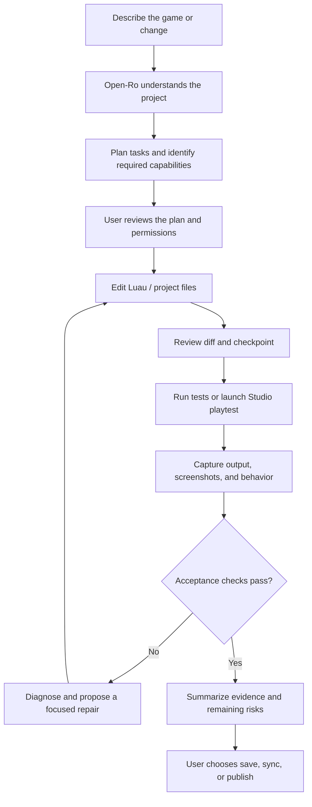

<div align="center">
  
  <p><strong>Your Roblox workspace. Your model. Your tools.</strong></p>
  <p>
    <a href="LICENSE"></a>
    <a href="https://github.com/cayleb-james2008/open-ro/actions/workflows/ci.yml"></a>
    
    
    
  </p>
  <p><em>Open-Ro is an independent, open-source AI development studio for creating, editing, testing, and shipping Roblox experiences.</em></p>
</div>

---

## The project in one sentence

**Open-Ro turns a natural-language idea into an editable Roblox project through a model-agnostic desktop agent, optional tools, and a repeatable build → test → inspect → repair loop.**

Open-Ro is being built for **Windows and native Linux desktops, including Omarchy (Arch Linux)**. Users bring a model connection; everything else is an optional capability they can install, connect, or skip.

> **Current release state: 0.1.0 foundation.** This repository contains an early Electron desktop client, provider routes, local project tools, approval-gated commands, an MCP client foundation, and Windows/Linux packaging configuration. It is not yet a complete Ropilot-equivalent product. The long-term target and the unfinished work are documented below and in [`docs/ROADMAP.md`](docs/ROADMAP.md). Native installers are configured and have not been acceptance-tested on a desktop machine.

## Interface

These screenshots are the renderer at 1280×800, opened in a browser without the Electron preload. The green notice on the chat screen is that missing-bridge state. Inside `npm run dev` the preload is present and that notice is not shown.


## What we are building

Open-Ro is not just a Luau autocomplete panel. It is intended to be a full development workspace with five connected parts:

1. **A model-agnostic agent workspace** — chat, project context, task planning, code edits, tool use, session history, review, and recovery.
2. **A Roblox Studio control plane** — inspect the DataModel, understand scripts and instances, edit Luau, run Studio operations, capture screenshots, simulate input, and diagnose test failures.
3. **A closed-loop development workflow** — plan, make a scoped change, review the diff, run or playtest, inspect evidence, repair, and repeat until the acceptance criteria pass.
4. **A creative asset pipeline** — optional Blender modeling/animation, image and thumbnail generation, asset review, and import into the game.
5. **An installable capability ecosystem** — Rojo, Git, MCP servers, local tools, and third-party providers are selectable add-ons, not mandatory infrastructure.

## The one-required-setup rule

A user should be able to install Open-Ro, connect one model, choose a project, and start working. No Open-Ro account, hosted inference proxy, subscription, or credit wallet is required.

### Model connections

Users can connect one or more model routes and choose which one is active. Supported routes in the current foundation are listed below; provider terms and available models remain controlled by their respective vendors.

| Route | How the user connects | Cost / account boundary | Current foundation |
|---|---|---|---|
| OpenAI API | API key | Direct OpenAI Platform billing | API route |
| ChatGPT subscription | Official Codex CLI sign-in | Subscription and limits handled by Codex | CLI handoff |
| Anthropic API | API key | Direct Anthropic Console billing | API route |
| Claude subscription | Official Claude Code sign-in | Sign-in and subscription handled by Claude Code | CLI handoff |
| OpenRouter | API key + model ID | OpenRouter billing and model routing | API-compatible route |
| OpenCode / OpenCode Go | Official OpenCode CLI sign-in | Provider account and OpenCode plan | CLI handoff |
| Ollama | Local endpoint + model | Local compute; no cloud key required | API-compatible route |
| Other OpenAI-compatible services | Base URL, model ID, optional key | Depends on selected service | Custom endpoint |

**Subscription credentials are not scraped or copied.** Where subscription access is exposed only through an official CLI, Open-Ro launches that unmodified CLI and lets it authenticate itself. Direct API-key use is available for users who prefer a conventional provider API. See [`docs/AUTH.md`](docs/AUTH.md).

### Optional capabilities

Everything outside the model connection is selected from a capability catalog. Each capability should explain what it unlocks, what it installs, whether an external account/key is needed, whether it is free or paid, the supported platforms, the permissions it receives, and how to test or remove it.

Examples: Roblox Studio MCP, Blender, Rojo, Git, image generation, 3D generation, local scripts, documentation MCPs, and community extensions. Users can skip all optional capabilities and still use the core chat and local project workspace.

## The target workflow



The model proposes work; Open-Ro enforces the user's selected permissions and gates. A successful tool call, model response, or green status badge is not proof that a Roblox experience works. The final result must be tied to observable checks.

## Product principles

- **One required dependency:** one working model connection. No mandatory second account.
- **Bring your own access:** users connect directly to providers and third-party services. Open-Ro does not sell inference credits or proxy vendor subscriptions.
- **Local-first by default:** projects, history, settings, and credentials stay on the user's machine unless a user-selected provider or integration receives data as part of a task.
- **Capability-driven:** integrations are independently selectable, installable, testable, and removable.
- **Permission before action:** file writes, shell commands, Studio mutations, uploads, and publishing require explicit scoped permissions and meaningful review.
- **Evidence over claims:** display what was inspected, changed, tested, skipped, or left uncertain.
- **Portable:** the same core product model across Windows and Linux, with OS-specific adapters and installers.
- **Independent implementation:** public behavior and documented interfaces may inform compatibility goals; no proprietary source, private APIs, credentials, or Ropilot branding are reused.

## Platform commitment

| Platform | Product target | Important qualification |
|---|---|---|
| Windows 10/11 x64 | Native desktop app and NSIS installer | Primary baseline for Roblox Studio integration and validation |
| Omarchy / Arch Linux x64 | Native desktop app, AppImage, and pacman package | The Open-Ro client must run natively; optional tools are discovered locally |
| Other Linux distributions | AppImage / Debian package where practical | Validate dependencies and desktop secret service per distribution |
| Roblox Studio on Linux | Best-effort bridge through Wine/Vinegar | Roblox does not officially support Studio on Linux; never promise parity without real-machine tests |

Windows and Linux are equal first-class targets for the Open-Ro desktop client. Roblox Studio's own platform limitations are separate from Open-Ro's platform support. See [`docs/PLATFORM-SUPPORT.md`](docs/PLATFORM-SUPPORT.md).

## Current feature status

| Area | 0.1.0 state | Target |
|---|---|---|
| Desktop shell | Implemented foundation | Polished multi-project workspace and onboarding |
| Provider connections | API routes and official CLI handoffs | Guided install/sign-in/test, model catalogue, routing, fallback |
| Local project access | Browse/read/write foundation | Diffs, checkpoints, ignore rules, rollback, multi-project context |
| Agent tools | Approval-gated shell and file operations | Typed permissions, task plans, progress, recovery and audit trail |
| MCP | One stdio server at a time | Multi-server registry, lifecycle management, granular approvals |
| Roblox Studio | MCP integration foundation | Full inspect/edit/playtest/screenshot/input/repair loop |
| Rojo | Setup guidance | Project mapping and sync status/workflow |
| Blender | Python task runner foundation | Reviewed modeling/animation and asset import/export pipeline |
| Images / thumbnails | Not implemented | Selectable provider adapters and asset review flow |
| 3D generation | Not implemented | Optional generation backends and Blender handoff |
| Windows packaging | Configured; not acceptance-tested | Signed installer and tested upgrade/uninstall path |
| Omarchy packaging | Configured; not acceptance-tested | Verified AppImage and pacman install/update/uninstall |

See [`docs/ROADMAP.md`](docs/ROADMAP.md) for milestones and acceptance criteria, and [`docs/BUILD-STATUS.md`](docs/BUILD-STATUS.md) for the exact verification boundary.

## Get started

The project is currently distributed as source; native installers have not yet passed release acceptance.

**Requirements:** Node.js 22.12+, npm 10+, Git, and the platform-specific desktop build prerequisites.

```bash
git clone https://github.com/cayleb-james2008/open-ro.git
cd open-ro
npm install
npm run dev
```

Build and package:

```bash
npm run typecheck
npm run lint
npm test
npm run package:win       # Windows x64 NSIS
npm run package:linux     # AppImage + deb + pacman
```

For Omarchy-specific instructions and keyring requirements, see [`docs/INSTALL.md`](docs/INSTALL.md). For model setup and official sign-in flows, see [`docs/AUTH.md`](docs/AUTH.md).

## Repository guide

| Path | Purpose |
|---|---|
| [`PROJECT.md`](PROJECT.md) | Canonical mission, standing goals, principles, scope, and project decisions |
| [`docs/PRODUCT-SPEC.md`](docs/PRODUCT-SPEC.md) | User journeys, requirements, functional scope, and acceptance criteria |
| [`docs/ROADMAP.md`](docs/ROADMAP.md) | Prioritized milestones, dependencies, and parity checklist |
| [`docs/ARCHITECTURE.md`](docs/ARCHITECTURE.md) | Desktop architecture, agent runtime, provider adapters, and integration boundaries |
| [`docs/PLATFORM-SUPPORT.md`](docs/PLATFORM-SUPPORT.md) | Windows, Omarchy, and Roblox Studio support matrix |
| [`docs/EXTENSIONS.md`](docs/EXTENSIONS.md) | Optional capabilities and extension safety model |
| [`docs/AUTH.md`](docs/AUTH.md) | Provider connection and subscription-safe authentication |
| [`docs/INSTALL.md`](docs/INSTALL.md) | Source setup and packaging instructions |
| [`docs/BUILD-STATUS.md`](docs/BUILD-STATUS.md) | What was and was not built or verified |
| [`docs/RELEASE-GATES.md`](docs/RELEASE-GATES.md) | Evidence required before a release can be called ready |
| [`CONTRIBUTING.md`](CONTRIBUTING.md) | Development, pull requests, and quality expectations |

## Contributing

Open-Ro is MIT-licensed and welcomes issue reports, implementation proposals, provider adapters, optional capability integrations, and platform testing. Start with [`CONTRIBUTING.md`](CONTRIBUTING.md) and the standing goals in [`PROJECT.md`](PROJECT.md). A proposed feature should solve a user workflow, preserve the one-required-setup rule, and include acceptance criteria.

## Legal and attribution

Open-Ro is an independent community project. It is not affiliated with Roblox Corporation, Ropilot, OpenAI, Anthropic, OpenRouter, or OpenCode. Product and company names identify compatibility targets only. Each optional tool, provider, model, and generated asset retains its own license and terms; see [`docs/EXTENSIONS.md`](docs/EXTENSIONS.md).

**License:** MIT. See [`LICENSE`](LICENSE).
