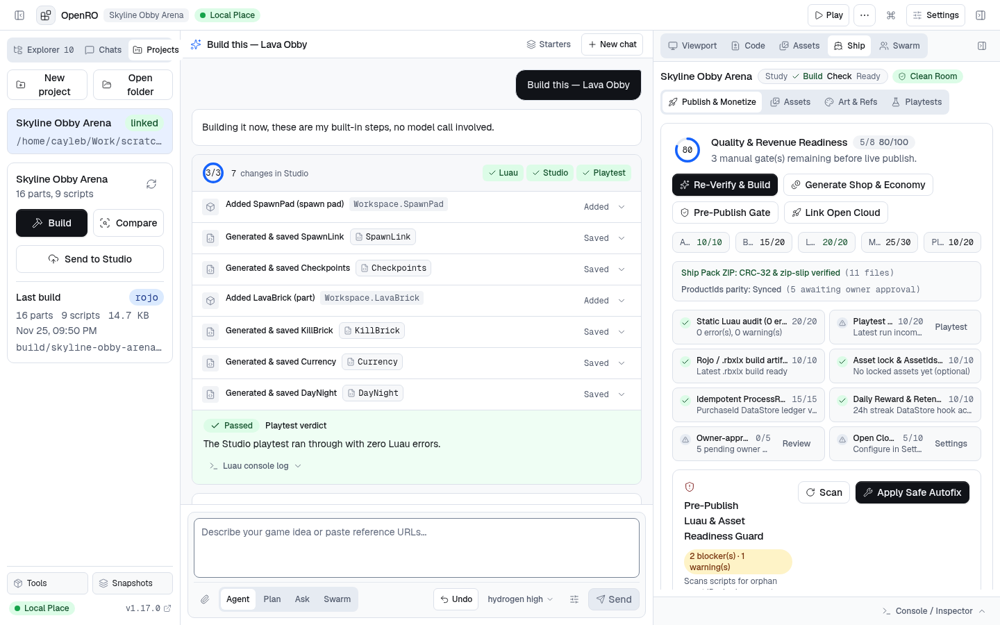
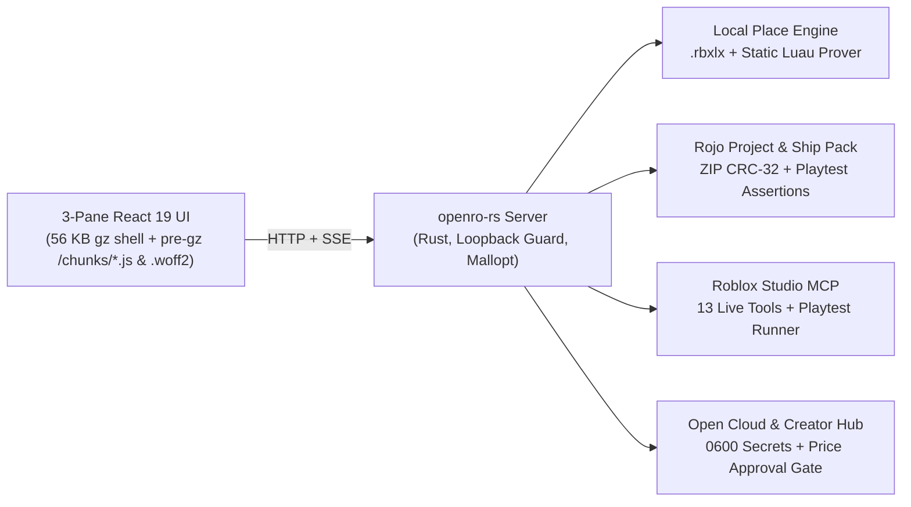

# OpenRO (`v1.9.0`)

[](https://github.com/cayleb-james2008/open-ro/releases/latest)
[](https://github.com/cayleb-james2008/open-ro/actions)
[](LICENSE)
[](#architecture)

**Single-binary cross-platform Roblox Studio AI IDE** (`openro-rs`) for building, verifying, monetizing, and publishing complete Roblox games end-to-end — from Rojo project scaffolding and multi-agent Teamwork to deterministic playtest assertion suites, genre retention presets, Creator Hub browser setup, and Roblox Open Cloud publishing.

<p align="center">
  <picture>
    <source media="(prefers-color-scheme: dark)" srcset="docs/screenshots/hero-dark.png" />
    
  </picture>
</p>

## Why OpenRO

- **Zero-lag 3-pane Studio Copilot:** Explorer, Agent/Plan/Ask thread with reviewable Luau diffs, and tabbed Studio Workbench (`Viewport`, `Code`, `Assets`, `Ship`, `Swarm`) served from a single `14.75 MB` binary (`56 KB` gzip initial shell).
- **1-Click Ship & Monetization Readiness:** Genre tier presets (`Starter Obby / Sim`, `Anime Gacha / RPG`, `Competitive Arena`) wire `MonetizationConfig.luau`, idempotent `ProcessReceipt`, 7-day escalating streak + 48h comeback bonus hooks, draft Robux tiers (`priceApproved: false` owner gate), and CRC-32 verified Rojo Ship Packs.
- **Deterministic Playtest Assertion Lab (`/play` / `#/lab`):** Structured per-room JSON assertions (`Luau`, `Runtime`, `Core Loop`, `Economy`, `Visuals`), 1-click **Re-Run All Assertions** with fixed/regressed diffs, and JSON report export.
- **Full Browser Demo Parity (`web-dist/index.html`):** Offline-capable standalone Studio web engine with zero external network calls.

## Feature Gallery

<table>
  <tr>
    <td width="50%" align="center">
      <strong>Ship &amp; Revenue Readiness Autopilot + Pre-Publish Gate</strong>
      <br /><br />
      <picture>
        <source media="(prefers-color-scheme: dark)" srcset="docs/screenshots/ship-readiness-dark.png" />
        
      </picture>
    </td>
    <td width="50%" align="center">
      <strong>Monetization Tier &amp; 48h Comeback Retention Designer</strong>
      <br /><br />
      <picture>
        <source media="(prefers-color-scheme: dark)" srcset="docs/screenshots/monetization-dark.png" />
        
      </picture>
    </td>
  </tr>
</table>

## Architecture



## Verified Benchmarks (`v1.9.0` vs `v1.2.0`)

| Metric | `v1.2.0` Baseline | `v1.9.0` Verified | Delta |
| --- | --- | --- | --- |
| Release Binary Size | `19.00 MB` | **`14.79 MB`** (`15,512,472 B`) | `-22.2%` |
| Initial `/` Payload | `~1,368 KB` raw / `~459 KB` gz | **`235.0 KB`** raw / **`56.2 KB`** gz | **`-87.8%` wire** |
| Cold Boot (`#154` pinned) | `1,470 ms` | **`21.36–33.66 ms`** (`/`: `25.64 ms`) | **`-97.7%`** |
| Peak RSS (`VmHWM`) | `115.20 MB` | **`8.98 MB`** (`9,196 KB`, 16w pinned) | **`-92.2%`** |
| Concurrent HTTP | `875 req/s` (`141.7 ms` p95) | **`30,907.0 req/s`** (`0.94 ms` p95, 16w pinned) | **`35.3x`** |
| Security & UI Gates | `43/43` fuzz | **`0` sloplint fails, `307` Rust tests** | Pass |

## Quick Start

```sh
# 1. Build the embedded single-file frontend and Rust release binary
npm --prefix frontend run build
touch src/lib.rs src/server.rs && cargo build --release --locked

# 2. Launch OpenRO (opens chromeless Studio window at http://127.0.0.1:8077; use --no-open for headless)
./target/release/openro-rs --no-open --port 8077

# 3. Verify Rust tests, Windows cross-check, and UI gates
cargo test -- --test-threads=2
cargo xwin check --target x86_64-pc-windows-msvc
npm --prefix frontend run check:ui -- --lints --skip-build
```

## Documentation & Cross-Platform Notes

- **Platforms:** Linux (`x86_64`, `aarch64`, `Xvfb`/Vinegar Studio embed), Windows (`x86_64-pc-windows-msvc`), macOS (`aarch64-apple-darwin`).
- **API References:** [Projects, Sync & Playtest](docs/API-V011.md) · [Multi-Agent Teamwork](docs/API-V011-teamwork.md) · [Creator Hub & Open Cloud](docs/API-V011-creator-hub.md) · [Assets & Mesh](docs/API-V011-assets.md) · [Study Ledger](docs/API-V011-study.md) · [Tool Adapters](docs/API-V011-adapters.md).
