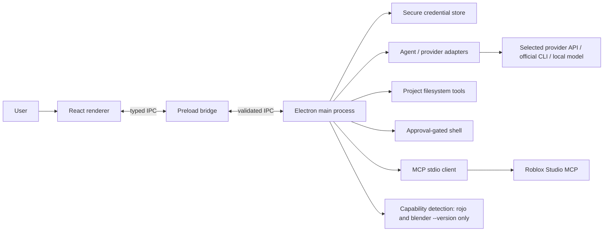

# Architecture overview

## 1. Current implementation

Open-Ro 0.1.0 is an Electron 45 + React 19 + TypeScript desktop application. Vite builds the renderer; the Electron main process owns privileged operations; a narrow preload bridge exposes typed methods to the UI.

The UI must never receive raw provider credentials, Node.js process objects, or unrestricted filesystem access. Renderer requests cross a typed IPC boundary and are checked in the main process.

## 2. Core modules

| Module | Responsibility |
|---|---|
| `src/` | Renderer UI, screens, styles, state and interaction |
| `design/tokens.json` | Locked design tokens (Catppuccin Mocha palette, one lavender accent, type, spacing, motion). `npm run tokens:build` generates `src/tokens.css`; `npm run lint` fails if it drifts or if raw colors or gradients appear elsewhere in `src/` |
| `src/comps/` | Dev-only `/comps/<state>` routes (`chat-empty`, `chat-approvals`, `loading`, `error`) that render the app against fixture data; excluded from production builds |
| `electron/main.ts` | App lifecycle, IPC registration, privileged operations and approval dialogs |
| `electron/preload.ts` | Narrow renderer bridge |
| `electron/agent.ts` | Agent loop, provider calls, tool schema and execution routing |
| `electron/providerCatalog.ts` | Provider definitions and connection routes |
| `electron/secureStore.ts` | Secure credential storage via Electron safeStorage |
| `electron/mcp.ts` | MCP stdio transport, tool discovery and calls |
| `electron/mcpTools.ts` | Exposes connected MCP tools to the agent as `mcp__<tool>`; calls are staged and run only after approval |
| `electron/playtestEvidence.ts` | Playtest report check: PASSED needs agent-reported assertions, state checks and a PNG path inside the project, with every expected value equal to the actual one. It checks completeness and consistency only; values and the screenshot are not verified against a run |
| `electron/capabilities.ts` | Optional local capability detection/metadata |
| `electron/types.ts` | Shared typed contracts |
| `tests/` | Deterministic tests for provider catalogue and other core logic |

## 3. Provider architecture

Separate provider identity, connection method, and model metadata:

- **Provider:** vendor/endpoint (OpenAI, Anthropic, OpenRouter, Ollama, custom).
- **Connection:** API key, official CLI session, local endpoint, or supported OAuth.
- **Model:** exact provider-scoped model ID and capability metadata.
- **Routing policy:** active/default model and future per-task overrides/fallbacks.

An API-key adapter sends a request only to its configured provider endpoint. A subscription CLI adapter invokes that provider's official executable; it must not parse the provider's credential store. Local models should use loopback endpoints and should remain available without network access.

## 4. Optional capability architecture (target)

Capabilities are adapters, not hard dependencies of the app. The future registry should maintain:

- Stable capability ID and version.
- Supported platforms and exact dependency requirements.
- Install source/publisher and checksum/signature where available.
- Required permissions and environment variables.
- Local process lifecycle and health check.
- Setup guide, official signup/download link, cost boundary, and removal path.
- MCP tool schemas or a typed native adapter contract.

The current application supports a single MCP stdio process at a time. Starting it and every agent tool call go through the approval queue. Multi-server lifecycle, per-tool permission scopes, automatic reconnect and a signed extension registry remain roadmap work.

## 5. Roblox Studio architecture

Prefer Roblox Studio's documented built-in MCP interface over proprietary or undocumented protocols. The Studio integration is a bridge from Open-Ro's agent runtime to the Studio-managed MCP tool server. Open-Ro should keep discovery, inspection and mutation permissions distinct.

Target flow:

1. Detect a reachable Studio MCP server.
2. Discover advertised tools and schemas.
3. Classify each tool as read-only, project mutation, test/playtest, upload, or publish.
4. Present tool availability and request approval for the required scope.
5. Call the tool and preserve structured result/evidence.
6. On failure, report the failure without pretending that the action succeeded.

The first Studio tools (`studio_snapshot`, `studio_read_script`, `studio_write_script`, in `electron/studioTools.ts`) are built on `execute_luau`. Reads and writes are both approval-gated. A read authorizes writes only on the same server session and `studio_id`. Writes compare against the reviewed source before changing it, ask ChangeHistoryService to record an undo step (the result says whether it did), and are read back. Each confirmed write saves a checkpoint, and restoring one is staged as another approved write. The argument names and reply format come from the published tool schema, not a live session.

The first implementation's one-server limit and lack of live Studio validation must remain visible until those constraints are removed and tested.

## 6. Local project and safety boundaries

- Project tools operate relative to the folder the user selected in the main process. A path sent by the renderer is not used as the root.
- Resolve paths with `realpath` and reject traversal, prefix siblings, and symlink escapes.
- Shell execution and file writes are staged in the main process. Approval sends an id; the stored command or file body is what runs. The tray shows the command and working directory, or a line diff, before approval.
- Destructive and publish actions need separate permission classes.
- Record before/after diffs and support rollback checkpoints.
- Credentials are stored via OS secure storage; no plaintext fallback.
- Network data flow is determined by selected model/provider and capability. UI must state what is sent externally.

## 7. Packaging

Electron Builder produces:

- Windows x64 NSIS installer.
- Linux AppImage and Debian package.
- Linux pacman package for Omarchy/Arch.

Native dependencies, secret-service availability, sandbox behavior, file permissions, app data paths, and update/uninstall behavior must be tested on real target machines. Packaging configuration alone is not release acceptance.

## 8. Architecture evolution

Recommended next architecture improvements:

1. Add a persistent local data layer for projects, chats, runs, approvals and checkpoints.
2. Split provider adapters from agent orchestration and normalize streaming/tool-call behavior.
3. Add typed permission scopes and per-capability grants.
4. Introduce a multi-MCP manager with process lifecycle and reconnect.
5. Add a job/evidence store for playtests, screenshots, logs and repair iterations.
6. Add capability manifests with signed/verified source metadata and uninstall support.
7. Add platform adapters for Windows process management and Linux/Omarchy packaging/runtime detection.
